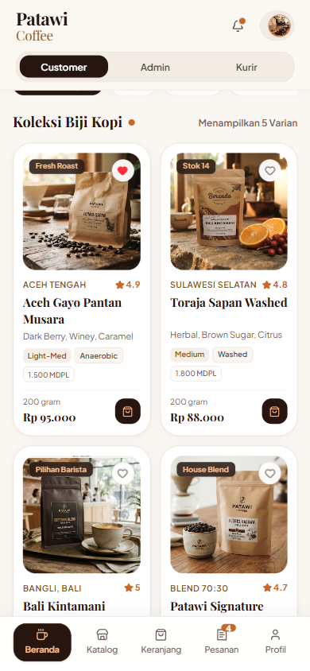
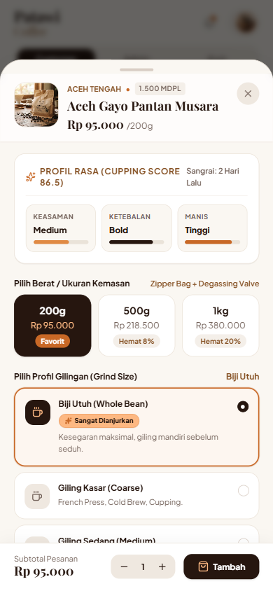
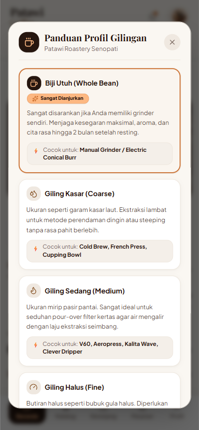
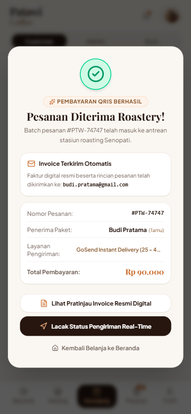
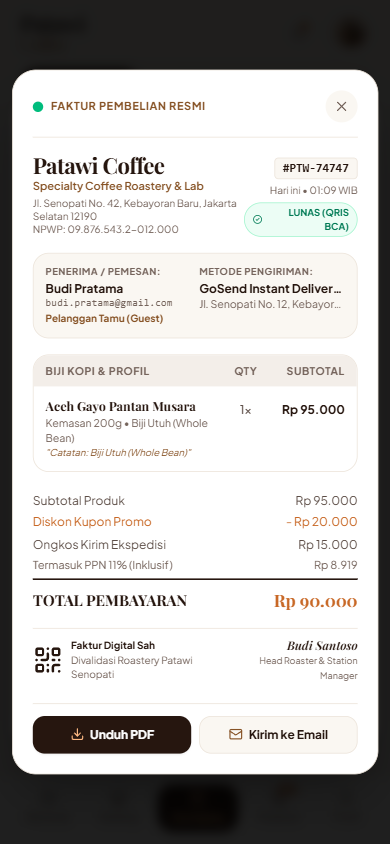
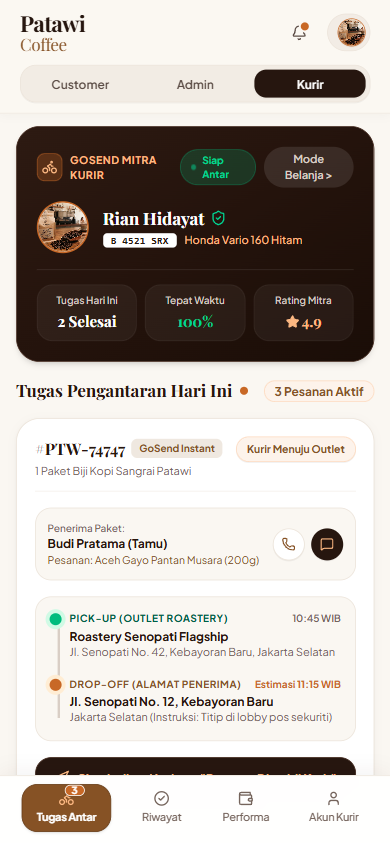
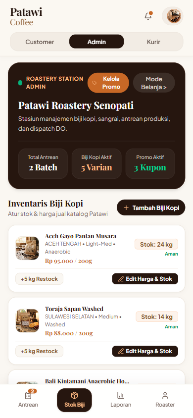
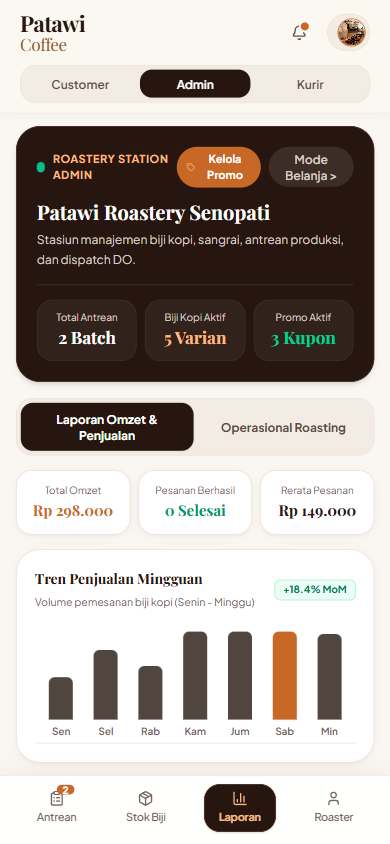
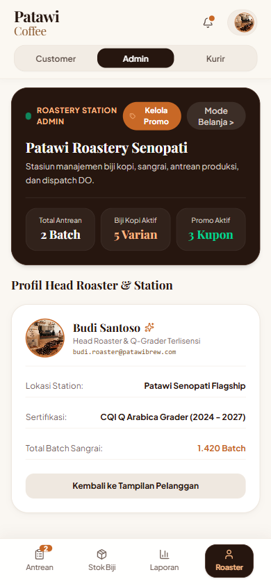

# Patawi-BrewSpace ☕

> **Patawi Coffee** — Aplikasi Web Pemesanan Kopi Artisanal & Sistem Operasional Specialty Roastery.
> Didesain secara interaktif, ramah pengguna, dan fungsional penuh untuk menghubungkan **Pembeli (Customer)**, **Pengelola Roastery (Admin/Owner)**, dan **Armada Kurir (Delivery Order)** dalam satu ekosistem yang terintegrasi.
>
> 🌟 **Branch `experiment`**: Telah di-upgrade dengan sistem desain **Anti-Slop** (bebas template generik AI), kedalaman taktil visual (*tactile depth*), tipografi *Playfair Display & Plus Jakarta Sans*, dan rangkaian 75 pengujian otomatis (*automated test suite*).

[](https://vitejs.dev/)
[](https://react.dev/)
[](https://www.typescriptlang.org/)
[](https://tailwindcss.com/)
[](tests/run-all.cjs)
[](anti-slop/)

---

## 💡 Apa Itu Patawi BrewSpace? (Penjelasan Singkat)

Bayangkan sebuah kedai sangrai kopi (*specialty roastery*) modern di Senopati, Jakarta. Website ini bukan sekadar toko online biasa, melainkan **sistem lengkap yang bekerja secara real-time** untuk tiga pihak:

1. **Pembeli (Customer)**: Bisa memilih biji kopi pilihan, menentukan tingkat gilingan sesuai alat seduhnya di rumah, checkout dengan akun member atau sebagai tamu tanpa ribet, memilih kurir pengiriman (GoSend / JNE / Ambil Sendiri), bayar pakai QRIS, hingga menerima faktur digital resmi.
2. **Pengelola / Pemilik (Admin Roastery)**: Bisa memantau pesanan masuk, memproses sangrai biji kopi di stasiun roasting, mengatur stok fisik & harga biji kopi, membuat kupon promo diskon, melihat grafik laporan omzet penjualan harian/mingguan, dan menyerahkan paket yang sudah siap ke kurir.
3. **Kurir Pengantar (Delivery Order / DO)**: Memiliki aplikasi kurir khusus untuk melihat daftar pesanan yang siap diantar, melihat rute dari outlet Senopati ke rumah pembeli, menghubungi pelanggan lewat WhatsApp/telepon dalam 1 klik, dan memperbarui status sampai paket berhasil diterima.

Semua alur ini dapat Anda coba langsung di browser hanya dengan mengklik tombol **Customer**, **Admin**, atau **Kurir** di bagian atas layar!

---

## 📸 Galeri Tampilan Aplikasi (Fixed & Production-Ready)

| Beranda (Nama Daerah Utuh & Rapi) | Kustomisasi Profil Cupping | Pilihan Gilingan "Sangat Dianjurkan" |
| :---: | :---: | :---: |
|  |  |  |

| Konfirmasi Pesanan & Email Alert | Faktur Pembelian Digital Resmi | Dashboard Kurir & Handover Gate |
| :---: | :---: | :---: |
|  |  |  |

| Admin Inventaris & Edit Stok/Harga | Admin Laporan Finansial & Omzet | Profil Head Roaster & Station |
| :---: | :---: | :---: |
|  |  |  |

---

## 🚀 Panduan Cara Menjalankan Aplikasi (Langkah Mudah)

Jika Anda baru pertama kali menjalankan proyek ini di komputer Anda, ikuti 3 langkah berikut:

### 1. Download / Clone Repository
Buka terminal (Command Prompt / PowerShell / Git Bash), lalu ketik:
```bash
git clone https://github.com/Natvelniel/Patawi-BrewSpace.git
cd Patawi-BrewSpace
```

### 2. Install Dependensi (Hanya Sekali)
Pastikan komputer Anda sudah terpasang [Node.js](https://nodejs.org/). Lalu jalankan:
```bash
npm install
```

### 3. Jalankan Aplikasi
Ketik perintah berikut untuk menyalakan server lokal:
```bash
npm run dev
```
Setelah itu, buka browser favorit Anda dan kunjungi tautan:
👉 **`http://localhost:5173`**

*(Opsional) Untuk mematikan server, tekan tombol `Ctrl + C` di terminal.*

### 4. Jalankan Pengujian Otomatis (Testing Suite)
Untuk memverifikasi keutuhan sistem dari logika kalkulasi, batas stok, hingga audit Anti-Slop:
```bash
node tests/run-all.cjs
```
> Menjalankan 15 berkas test suite (75 skenario) dengan hasil **75/75 PASSING**.

---

## 🧭 Panduan Alur 3 Peran Pengguna (Cara Mencoba Fitur)

Untuk mencoba seluruh simulasi, gunakan tombol switcher peran di bagian paling atas:
`[ Customer ]` `[ Admin ]` `[ Kurir ]`.

```
           ┌──────────────────────────────────────────────┐
           │        PATAWI BREWSPACE ROLE SWITCHER        │
           │   [ Customer ]     [ Admin ]     [ Kurir ]   │
           └──────┬─────────────────┬─────────────┬───────┘
                  │                 │             │
        Belanja & Checkout     Atur Roastery  Antar Paket
```

---

### 👤 1. Alur Customer (Pembeli)

1. **Jelajahi Beranda & Katalog Biji Kopi**:
   - Lihat aneka biji kopi specialty Indonesia (*Aceh Gayo, Toraja Sapan, Bali Kintamani, Flores Bajawa*).
   - Klik kategori metode seduh (*Single Origin, Espresso, Filter Roast, Cold Brew*) atau tombol filter untuk mencari kopi sesuai preferensi rasa dan budget.
2. **Pilih Ukuran & Tingkat Gilingan**:
   - Klik salah satu kartu kopi untuk membuka lembar detail.
   - Pilih ukuran kemasan: `200g` (standar), `500g` (hemat 8%), atau `1kg` (hemat 20%).
   - Pilih profil gilingan: *Biji Utuh (Whole Bean - Sangat Dianjurkan)*, *Giling Kasar (Cold Brew)*, *Giling Sedang (V60)*, atau *Giling Halus (Espresso)*.
   - Klik tombol **Tambah ke Keranjang**.
3. **Periksa Keranjang Belanja**:
   - Masukkan kode kupon diskon (contoh: `PATAWIFRESH` untuk potongan Rp 20.000 atau `BEANS20`).
   - Ubah jumlah atau tambahkan catatan khusus seduhan.
   - Klik **Lanjut ke Pengiriman**.
4. **Pilih Identitas Pemesan & Ekspedisi**:
   - **Gunakan Akun Member** (Nathaniel Christian) ATAU **Checkout sebagai Tamu (Guest)** dengan mengetik Nama, Email, dan No. WhatsApp sendiri.
   - Pilih kurir pengiriman:
     - 🛵 *GoSend Instant (Jakarta)* — Rp 15.000 (Kilat 25-40 Menit)
     - 📦 *JNE Regular / SiCepat* — Rp 22.000 (2-3 Hari Se-Indonesia)
     - ⚡ *JNE YES (Next Day)* — Rp 35.000 (Besok Sampai)
     - 🏪 *Pick Up Sendiri di Outlet Senopati* — Gratis
5. **Pembayaran QRIS Dinamis**:
   - Klik **Bayar dengan QRIS Dinamis**.
   - Muncul kode QRIS standar Bank Indonesia.
   - Klik tombol demo: **"Simulasikan Pembayaran Berhasil"**.
   - *Catatan: Jika Anda menutup modal QRIS, isi keranjang belanja tidak akan hilang dan tetap tersimpan.*
6. **Layar Konfirmasi Sukses & Faktur Resmi**:
   - Muncul pesan sukses: *"Invoice digital resmi telah dikirimkan ke email Anda"*.
   - Klik tombol **Lihat Pratinjau Invoice Resmi Digital** untuk melihat nota faktur lengkap dengan nomor faktur, rincian biaya, PPN 11%, QR validasi, dan tanda tangan roaster.
   - Klik **Lacak Status Pengiriman** untuk melihat posisi kurir di peta live GPS.

---

### ☕ 2. Alur Admin / Owner (Pengelola Roastery)

Klik tombol **`Admin`** di header atas untuk masuk ke stasiun operasional roastery Senopati:

1. **Tab Antrean (Queue)**:
   - Melihat pesanan yang baru saja dibuat oleh customer secara real-time.
   - Klik tombol **"Majukan Tahap"** untuk mensimulasikan proses sangrai: *Pesanan Dikonfirmasi → Roasting, Grinding & Packing*.
   - **Gerbang Serah Terima Kurir (Handover Gate)**: Saat pesanan selesai dipacking, muncul tombol oranye **"Serahkan ke Kurir DO (Siap Diantar) 🛵"**. Klik tombol ini agar pesanan resmi diteruskan ke antrean kurir pengantar.
2. **Tab Stok Biji (Inventory)**:
   - Melihat daftar inventaris stok fisik kopi (kg) dan statusnya (*Aman* atau *Menipis*).
   - Klik tombol **"+ Tambah Biji Kopi"** untuk menambah produk baru ke katalog pembeli.
   - Klik tombol **"Edit Harga & Stok"** pada produk apa pun untuk mengubah harga jual dasar atau menambah stok secara instan.
   - Klik **"+5 kg Restock"** untuk menambah stok cepat tanpa buka form.
3. **Tab Laporan (Reports & Revenue)**:
   - Melihat omzet pemasukan penjualan (Rp), jumlah pesanan selesai, dan rata-rata nilai belanja (AOV).
   - Dilengkapi **Grafik Batang Penjualan Mingguan (Senin–Minggu)** yang otomatis terhitung.
4. **Tombol Kelola Promo**:
   - Klik tombol **"Kelola Promo"** di header admin untuk membuat kupon voucher baru atau menonaktifkan kupon yang sudah kedaluwarsa.
5. **Tab Roaster (Profile)**:
   - Melihat profil resmi Head Roaster *Budi Santoso* dan sertifikasi CQI Q-Grader berlisensi.

---

### 🛵 3. Alur Delivery Order (DO / Kurir Mitra)

Klik tombol **`Kurir`** di header atas untuk masuk ke mode armada kurir:

1. **Header & Status Mitra**:
   - Menampilkan identitas kurir *Rian Hidayat*, motor Honda Vario Hitam, dan plat nomor `B 4521 SRX`.
   - Indikator status aktif *"Siap Antar"* dengan 3 metrik performa (*Tugas Hari Ini*, *Tepat Waktu 100%*, *Rating Mitra ★ 4.9*).
2. **Daftar Tugas Pengantaran Hari Ini**:
   - Hanya menampilkan pesanan yang **sudah diserah-terimakan oleh Admin Roastery**.
   - Jika admin masih menyangrai biji kopi di dapur, kurir akan melihat kotak pengingat ramah *"Menunggu Penyiapan Roastery"*.
3. **Detail Penerima & Rute Pengantaran**:
   - Menampilkan nama pemesan (Member / Tamu) dan paket kopi yang dibawa.
   - Tombol cepat untuk **menelepon pelanggan** atau **chat WhatsApp langsung**.
   - Stepper rute yang menghubungkan titik *Pick-up Outlet Senopati* menuju *Alamat Drop-off Pelanggan*.
4. **Perbarui Status Pengantaran**:
   - Klik tombol simulasi: *"Pesanan Diambil Kurir"* → *"Pesanan Selesai Diterima"*.
5. **Tab Riwayat & Performa**:
   - Tab **Riwayat**: Melihat arsip paket yang telah sukses diserahkan hari ini.
   - Tab **Performa**: Melihat saldo dompet komisi kurir dan total pendapatan hari ini.

---

## 🎨 Ringkasan Pembenahan Visual UI & Anti-Slop (Craftsmanship)

Aplikasi pada branch `experiment` ini telah melalui pembersihan visual dan perombakan arsitektur desain secara menyeluruh:
- **Prinsip Anti-Slop (No Generic AI UI)**: 
  - Tidak ada gradien warna ungu/biru neon khas AI generik.
  - Tidak ada badge palsu ("AI-Powered", "Next-Gen", dll) atau buzzword korporat.
  - Tidak ada kartu melayang (*ghost cards*) tanpa batas tegas; semua wadah informasi menggunakan kontur 1px yang nyata (*tactile border*) dengan rim-light hangat.
  - Zero em dashes (`—`) di seluruh teks antarmuka maupun kode program.
- **Hierarki Tipografi Berkarakter**:
  - Judul editorial dan display menggunakan **Playfair Display** yang memancarkan aura roastery klasik premium.
  - Kontrol, label, tombol, dan teks isi menggunakan **Plus Jakarta Sans** dengan kontras tinggi yang memenuhi standar aksesibilitas WCAG AA/AAA.
- **Ergonomi Sentuhan & Mobile-First**: Semua tombol navigasi, filter, dan tab interaktif memiliki tap target minimal 44 × 44 px, aman digunakan di satu tangan pada layar ponsel (390px hingga 430px) maupun layar desktop.
- **Zero Ellipsis pada Nama Daerah**: Asal daerah seperti `ACEH TENGAH`, `SULAWESI SELATAN`, dan `BANGLI, BALI` tampil penuh 100% tanpa terpotong (`ACEH...`).
- **Profil Rasa Cupping Sejajar**: Indikator *Keasaman, Ketebalan, dan Manis* disajikan dalam 3 micro-card rapi dengan progress bar rata dasar, menghilangkan tumpang-tindih teks.
- **Panduan Gilingan "Sangat Dianjurkan"**: Lencana rekomendasi utama berbalut aksen emas roastery dengan ikon sparkles dan border tebal 2px.
- **Privasi Pengguna**: Email pelanggan pada profil disamarkan secara otomatis (`nat••••••09@gmail.com`).
- **Foto Profil Roaster Sempurna**: Foto profil Head Roaster Budi Santoso tampil bersih dengan fallback otomatis bebas gambar rusak.
- **Navigasi Kontekstual Peran**: Menu bawah otomatis menyesuaikan diri (Menu Belanja untuk Customer, Menu Roastery untuk Admin, dan Menu Tugas untuk Kurir).

---

## 🛠️ Teknologi & Arsitektur Kode

- **Frontend Core:** [React 19](https://react.dev/) + [TypeScript](https://www.typescriptlang.org/)
- **Bundler & Dev Server:** [Vite 6](https://vitejs.dev/) (Build super cepat < 2.5 detik)
- **Styling & Design Tokens:** [Tailwind CSS v4](https://tailwindcss.com/) dengan palet warna bumi artisanal (`#26160F`, `#FAF7F2`, `#C86826`, `#FDB882`)
- **Icon Set:** [Lucide React](https://lucide.dev/)
- **Typography:** Playfair Display (Headings) & Plus Jakarta Sans (Body)
- **Global Store:** React Context API (`StoreContext.tsx`) dengan *lifted-state architecture* untuk sinkronisasi instan antar-peran tanpa perlu reload halaman.

---

## 📄 Lisensi & Kredit

Dibuat dengan cinta untuk ekosistem specialty coffee Indonesia. Dikembangkan berdasarkan Sistem Desain Patawi Coffee sebagai portofolio implementasi antarmuka berstandar industri.
