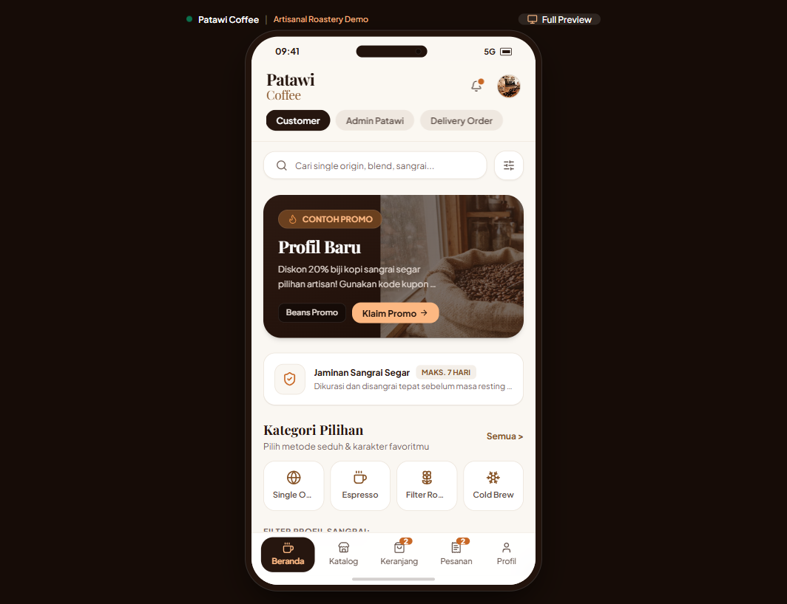
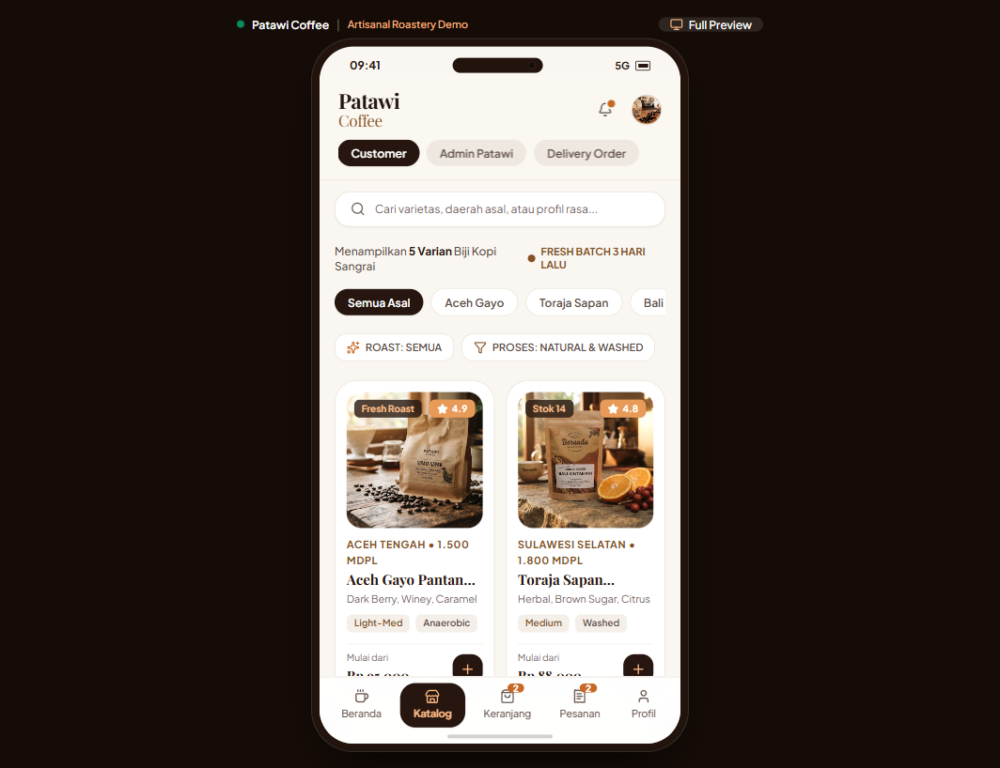
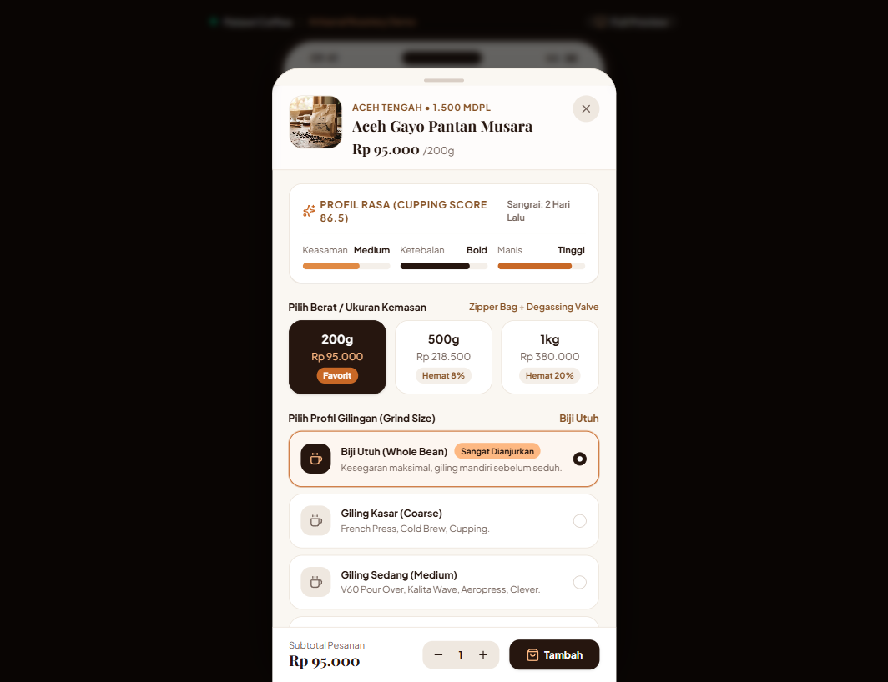
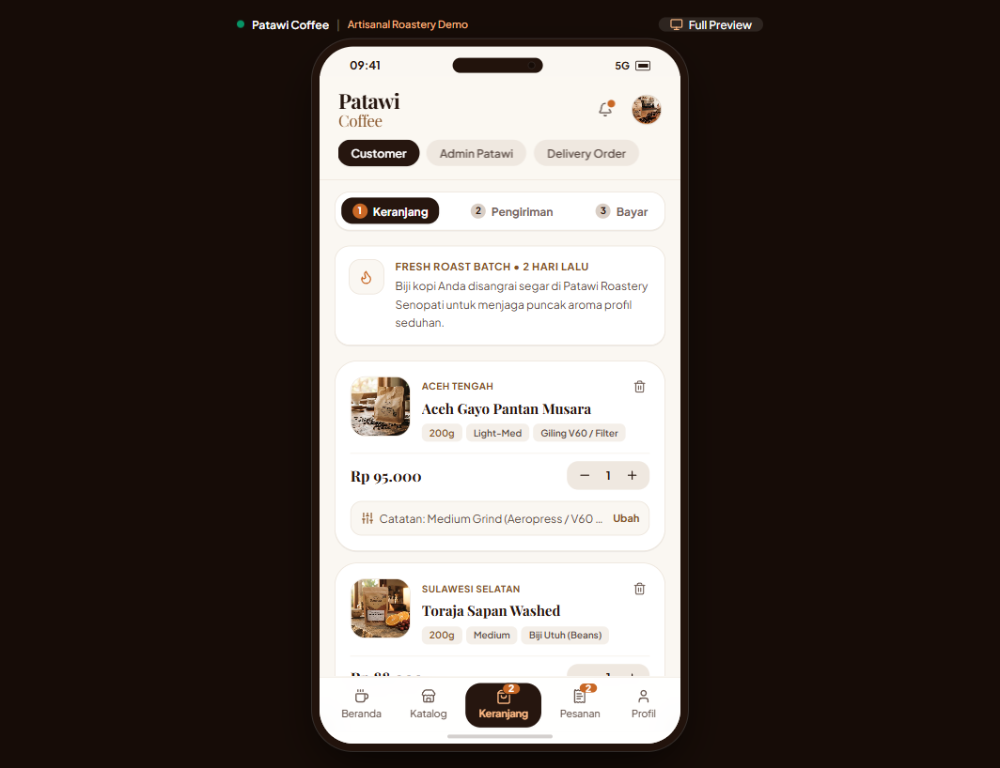
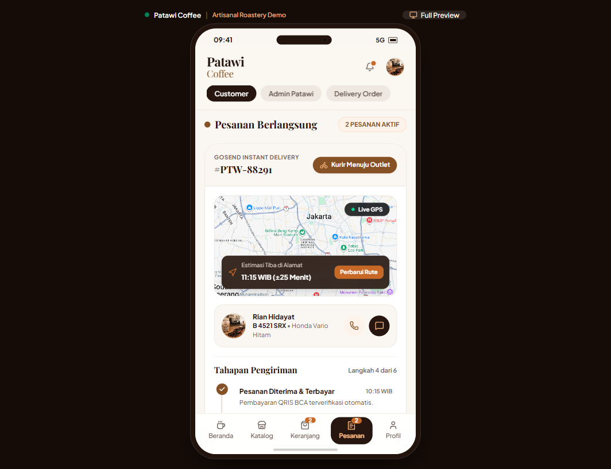

# Patawi-BrewSpace ☕

> **Patawi Coffee** — Aplikasi Web Pemesanan Kopi Artisanal & Specialty Roastery. Dibuat berdasarkan Sistem Desain Figma Patawi Coffee secara interaktif, responsif, dan fungsional penuh.

[](https://vitejs.dev/)
[](https://react.dev/)
[](https://www.typescriptlang.org/)
[](https://tailwindcss.com/)

---

## 📸 Preview Tampilan Aplikasi (UI Refresh)

| Beranda & Promo | Katalog Biji Kopi | Modal Varian & Cupping |
| :---: | :---: | :---: |
|  |  |  |

| Keranjang & Stepper Checkout | Pelacakan Pesanan & Live GPS |
| :---: | :---: |
|  |  |

---

## 🌟 Fitur Utama

- **Desain Otentik & Responsive (Mobile-First):**
  - Mengadaptasi sistem desain dari Figma (`4w9MNCQRO1UHqnjsssakY4`).
  - **Zero Floating Navigation**: Bilah navigasi bawah dan home indicator terkunci presisi di dalam frame smartphone saat dibuka di browser desktop.
  - **Tipografi Harmonis**: `Playfair Display` (Serif untuk Judul/Brand) & `Plus Jakarta Sans` (UI Sans-serif).
  - **Palet Artisan Earth-Tone**: `#26160F` (Dark Roast Espresso), `#FAF7F2` (Warm Milk Cream), `#C86826` (Caramel Honey).
  - Ritme spasi konsisten 8pt, eliminasi AI slop, dan kontras rasio ramah aksesibilitas (WCAG AA).

- **Eksplorasi Katalog & Beranda:**
  - Pencarian real-time biji kopi berdasarkan nama, varietas origin, dan flavor notes.
  - Banner promo interaktif dengan tombol klaim kode voucher otomatis.
  - Filter metode seduh (*Single Origin, Espresso, Filter Roast, Cold Brew*).
  - Filter profil sangrai (*Semua, Light, Medium, Medium-Dark*).
  - Panduan ukuran gilingan (*Grind Size Guide Modal*).

- **Kustomisasi Varian Produk (Bottom Sheet Modal):**
  - Indikator profil rasa visual (Cupping Score, Keasaman, Ketebalan, Manis).
  - Pilihan berat kemasan: `200g` (Favorit), `500g` (Hemat 8%), `1kg` (Hemat 20%) dengan kalkulasi harga otomatis.
  - Pilihan profil gilingan: *Whole Bean, Giling Kasar (Cold Brew), Giling Sedang (V60), Giling Halus (Espresso)*.
  - Input catatan seduhan khusus untuk barista/roaster.

- **Keranjang Belanja & Alur Checkout 3 Tahap:**
  - Stepper interaktif: *1. Keranjang → 2. Pengiriman → 3. Bayar*.
  - Kupon diskon promo (contoh: `PATAWIFRESH` & `BEANS20`).
  - Pilihan opsi pengiriman: *GoSend Instant* atau *Pick Up di Outlet Senopati*.
  - Simulator pembayaran dinamis **QRIS BCA** dengan countdown timer dan verifikasi otomatis.

- **Pelacakan Pesanan Real-Time (Live Tracking):**
  - **GoSend Instant:** Tampilan peta GPS live Jakarta, radar pulse, estimasi tiba (ETA), profil kurir, tombol telepon, dan **live chat langsung dengan driver**.
  - **Linimasa 6 Tahap Pengiriman:** *Pesanan Diterima → Konfirmasi Roastery → Roasting & Packing → Kurir Menuju Outlet → Diambil Kurir → Selesai*.
  - **Pick Up di Outlet:** Menampilkan **PIN 4 Digit Barista** besar (`7 4 9 2`) serta navigasi rute ke outlet Senopati.
  - **Riwayat Pesanan:** Fitur *Pesan Lagi* (reorder) dan unduh invoice.

- **Multi-Role Header Switcher:**
  - **Customer:** Pengalaman belanja pembeli.
  - **Admin Patawi:** Manajemen antrean roasting station dan monitor suhu drum mesin sangrai (205°C).
  - **Delivery Order:** Tampilan kurir GoSend untuk rute pengantaran paket kopi.

---

## 🛠️ Tech Stack

- **Framework:** [React 19](https://react.dev/) + [TypeScript](https://www.typescriptlang.org/) + [Vite](https://vitejs.dev/)
- **Styling:** [Tailwind CSS v4](https://tailwindcss.com/)
- **Icons:** [Lucide React](https://lucide.dev/)
- **Fonts:** Playfair Display, Plus Jakarta Sans

---

## 📁 Struktur Proyek

```
UI/
├── docs/
│   └── screenshots/          # Tangkapan layar tampilan aplikasi
├── public/
│   └── assets/               # Aset vektor (SVG) dan gambar lokal dari Figma
├── src/
│   ├── components/
│   │   ├── admin/            # Tampilan Dashboard Roastery Admin
│   │   ├── cart/             # Keranjang & Modal Pembayaran QRIS
│   │   ├── catalog/          # Katalog Produk & Modal Varian (Cupping score, grind size)
│   │   ├── delivery/         # Dashboard Kurir Pengiriman
│   │   ├── home/             # Beranda, Banner Promo, & Modal Panduan Gilingan
│   │   ├── layout/           # Header (Role Switcher) & Bottom Navigation
│   │   ├── profile/          # Profil Member, Poin Patawi, & Pengaturan
│   │   └── tracking/         # Pelacakan GPS, Chat Driver, & PIN Barista
│   ├── context/
│   │   └── StoreContext.tsx  # Global State Management (Cart, Voucher, Orders, Roles)
│   ├── data/
│   │   └── coffeeProducts.ts # Mock Data Biji Kopi Specialty & Pesanan Aktif
│   ├── types/
│   │   └── index.ts          # Definisi TypeScript Interfaces & Enums
│   ├── App.tsx               # Root Component dengan Device Frame & Tab Router
│   ├── index.css             # Konfigurasi Tailwind CSS v4 & Utilitas Desain
│   └── main.tsx              # Entry Point React DOM
└── package.json
```

---

## 🚀 Menjalankan Secara Lokal

1. **Clone repository:**
   ```bash
   git clone https://github.com/Natvelniel/Patawi-BrewSpace.git
   cd Patawi-BrewSpace
   ```

2. **Install dependensi:**
   ```bash
   npm install
   ```

3. **Jalankan development server:**
   ```bash
   npm run dev
   ```
   Buka browser Anda di `http://localhost:5173`.

4. **Build untuk produksi:**
   ```bash
   npm run build
   ```

---

## 📄 Lisensi

Dibuat untuk keperluan demonstrasi dan pengembangan portofolio sistem desain digital.
