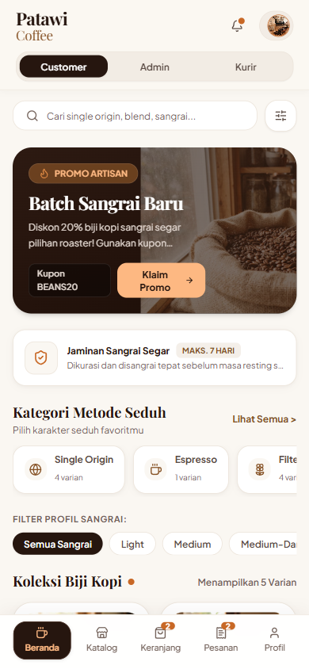
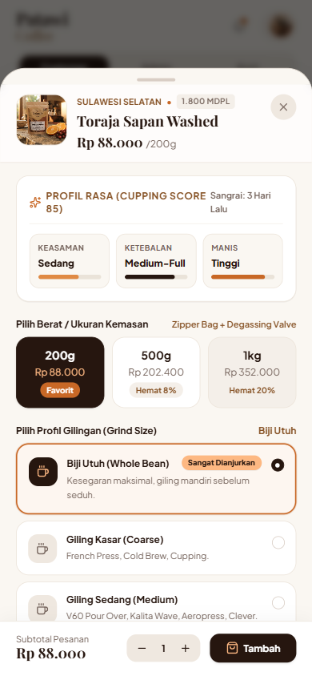
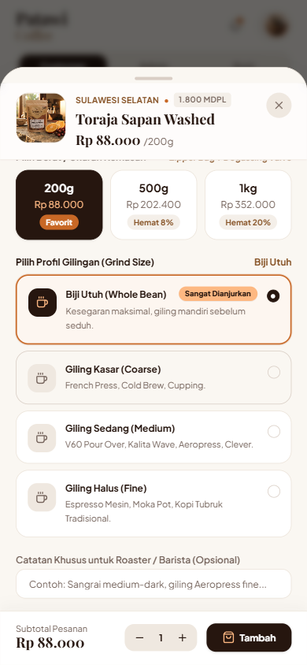
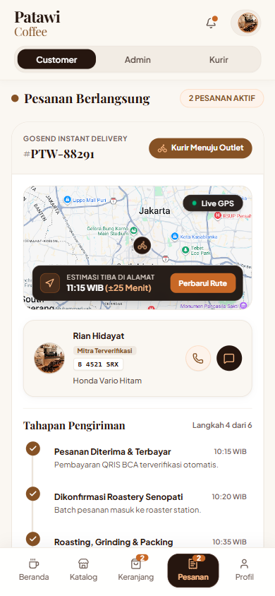
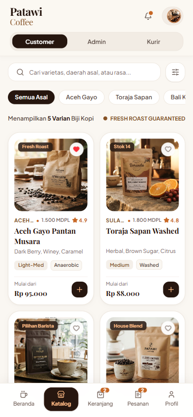
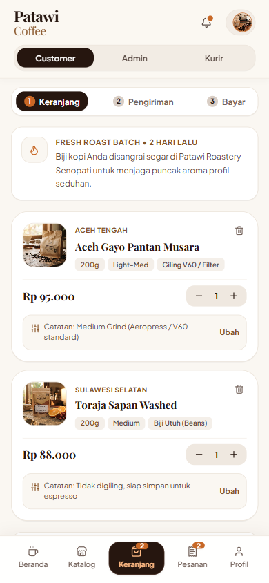

# Patawi-BrewSpace ☕

> **Patawi Coffee** — Aplikasi Web Pemesanan Kopi Artisanal & Specialty Roastery. Dibuat berdasarkan Sistem Desain Figma Patawi Coffee secara interaktif, responsif, dan fungsional penuh. Berstandar **Production Ready** dengan kedalaman visual (*visual depth*), ritme spasi 8pt, autentikasi multi-peran, dan filter interaktif multi-kriteria.

[](https://vitejs.dev/)
[](https://react.dev/)
[](https://www.typescriptlang.org/)
[](https://tailwindcss.com/)

---

## 📸 Preview Tampilan Aplikasi (Fixed & Production-Ready)

| Beranda (Segmented Role Bar) | Kustomisasi & Profil Cupping | Pilihan Gilingan Lengkap |
| :---: | :---: | :---: |
|  |  |  |

| Pelacakan Live GPS & Driver Card | Katalog Biji Kopi Aligned | Keranjang & Catatan Seduhan |
| :---: | :---: | :---: |
|  |  |  |

---

## 🌟 Fitur Utama

- **Desain Otentik & Bebas Tabrakan Visual (Anti-Slop Craft):**
  - **Segmented Role Switcher**: Kontrol navigasi 3 tab simetris (`Customer` | `Admin` | `Kurir`) dengan kontainer rounded-2xl dan elevasi tegas tanpa overflow pada layar terkecil sekalipun.
  - **Profil Rasa Cupping Sejajar (3 Stat Cards)**: Menghapus tabrakan teks dan efek tangga zig-zag menjadi 3 micro-card vertikal presisi (Keasaman, Ketebalan, Manis) dengan progress bar lurus sejajar di dasar card.
  - **Ketinggian MDPL & Badge Utuh**: Format `whitespace-nowrap` memastikan ketinggian `1.800 MDPL` tidak pernah pecah sendirian ke baris kedua.
  - **Pilihan Profil Gilingan Utuh**: Judul dan lencana rekomendasi dipisahkan secara fleksibel; deskripsi alat seduh (*V60 Pour Over, Aeropress, Espresso Mesin, Moka Pot*) tampil 100% lengkap tanpa elipsis (`truncate`).
  - **Kartu Driver & Rute Peta Rapi**: Nomor plat `B 4521 SRX` disematkan dalam micro-pill putih bersih dan nama motor `Honda Vario Hitam` tampil utuh tanpa pemotongan kata.
  - **Catatan Keranjang Multi-Line**: Catatan gilingan khusus pesanan di keranjang belanja tampil lengkap dan rapi tanpa terpotong.
  - **Zero Badge Collisions**: Badge status di kiri atas dan tombol favorit di kanan atas gambar; rating bintang diposisikan rapi di baris metadata.
  - **Zero Drowning Navigation**: Dilengkapi `viewport-fit=cover`, padding aman `env(safe-area-inset-bottom)`, dan layout fleksibel penuh.

- **Fungsi Autentikasi & Manajemen Akun (Login System):**
  - **Modal Autentikasi Cerdas (`AuthModal.tsx`)**: Form login dan registrasi dengan validasi email/kata sandi dan toggle visibilitas kata sandi.
  - **1-Click Quick Demo Login**: Beralih akun seketika dalam 1 klik untuk pengujian:
    - 👤 **Nathaniel Christian**: Pelanggan VIP Gold Member (1.250 Poin)
    - ☕ **Budi Santoso**: Head Roaster Outlet Senopati (Admin)
    - 🛵 **Rian Hidayat**: Mitra Kurir GoSend Express (Delivery)
  - **Sinkronisasi Profil & Header**: Klik avatar di header atau menu profil langsung membuka manajemen akun, rincian poin, serta opsi keluar/logout fungsional.

- **Sistem Filter & Sortir Interaktif Multi-Kriteria:**
  - **Quick Filter Kategori**: Klik chip kategori metode seduh (misal: *Cold Brew*) langsung menyaring daftar produk secara instan dan menampilkan chip filter aktif yang dapat dihapus.
  - **Advanced Filter Drawer (`FilterModal.tsx`)**:
    - *Metode Seduh*: Semua, Single Origin, Espresso, Filter Roast, Cold Brew
    - *Profil Sangrai*: Semua, Light, Medium, Medium-Dark
    - *Proses Pascapanen*: Semua, Anaerobic, Washed, Honey, House Blend
    - *Rentang Harga*: Semua, < Rp 85.000, Rp 85.000 - Rp 100.000, > Rp 100.000
    - *Urutkan Berdasarkan*: Paling Sesuai, Rating Tertinggi, Harga Terendah, Harga Tertinggi, Cupping Score
  - **Live Result Counter**: Tombol *Tampilkan X Biji Kopi* dinamis dan tombol *Reset Semua Filter*.

- **Kustomisasi Varian Produk (Bottom Sheet Modal):**
  - Indikator profil rasa visual (Cupping Score, Keasaman, Ketebalan, Manis).
  - Pilihan berat kemasan: `200g` (Favorit), `500g` (Hemat 8%), `1kg` (Hemat 20%) dengan kalkulasi harga otomatis.
  - Pilihan profil gilingan: *Whole Bean, Giling Kasar (Cold Brew), Giling Sedang (V60), Giling Halus (Espresso)*.
  - Input catatan seduhan khusus untuk barista/roaster.

- **Keranjang Belanja & Alur Checkout 3 Tahap:**
  - Stepper interaktif: *1. Keranjang → 2. Pengiriman → 3. Bayar*.
  - Kupon diskon promo (contoh: `PATAWIFRESH` & `BEANS20`).
  - Pilihan pengiriman: *GoSend Instant* atau *Pick Up di Outlet Senopati*.
  - Simulator pembayaran dinamis **QRIS BCA** dengan countdown timer dan verifikasi otomatis.

- **Pelacakan Pesanan Real-Time (Live Tracking):**
  - **Bip Live GPS Presisi**: Indikator radar konsentris hijau yang berkedip tepat di tengah badge Live GPS.
  - **Pin Kurir Dinamis**: Ikon motor kurir GoSend berdenyut langsung di atas peta Jakarta.
  - **WhatsApp Roastery Hotline**: Layanan pelanggan resmi prototipe dengan nomor bersih `+62 812-0000-8888`, tombol salin cepat, dan status online real-time.
  - **PIN 4 Digit Barista**: Tampilan kode penjemputan outlet Senopati (`7 4 9 2`).

---

## 🛠️ Tech Stack

- **Framework:** [React 19](https://react.dev/) + [TypeScript](https://www.typescriptlang.org/) + [Vite](https://vitejs.dev/)
- **Styling:** [Tailwind CSS v4](https://tailwindcss.com/)
- **Icons:** [Lucide React](https://lucide.dev/)
- **Fonts:** Playfair Display, Plus Jakarta Sans

---

## 📁 Struktur Proyek

```
UI/
├── docs/
│   └── screenshots/          # Tangkapan layar tampilan aplikasi (Mobile & Desktop)
├── public/
│   └── assets/               # Aset vektor (SVG) dan gambar lokal dari Figma
├── src/
│   ├── components/
│   │   ├── admin/            # Tampilan Dashboard Roastery Admin
│   │   ├── auth/             # Modal Autentikasi Pengguna & Quick Demo Login
│   │   ├── cart/             # Keranjang & Modal Pembayaran QRIS
│   │   ├── catalog/          # Katalog Produk, Modal Varian, & Filter Drawer
│   │   ├── delivery/         # Dashboard Kurir Pengiriman
│   │   ├── home/             # Beranda, Chip Kategori, Banner Promo, & Panduan Gilingan
│   │   ├── layout/           # Header (Role Switcher & Avatar Auth) & Bottom Navigation
│   │   ├── profile/          # Profil Member, Poin Patawi, & Pengaturan Akun
│   │   └── tracking/         # Pelacakan GPS, Chat Driver, Hotline WhatsApp, & PIN Barista
│   ├── context/
│   │   └── StoreContext.tsx  # Global State Management (Auth, Filter, Cart, Orders, Roles)
│   ├── data/
│   │   └── coffeeProducts.ts # Mock Data Biji Kopi Specialty, Akun Demo, & Pesanan
│   ├── types/
│   │   └── index.ts          # Definisi TypeScript Interfaces & Enums
│   ├── App.tsx               # Root Component dengan Device Frame & Safe-Area Layout
│   ├── index.css             # Konfigurasi Tailwind CSS v4, Token Kedalaman, & Utilitas
│   └── main.tsx              # Entry Point React DOM
└── package.json
```

---

## 🚀 Menjalankan Secara Lokal

1. **Clone repository:**
   ```bash
   git clone https://github.com/Natvelniel/Patawi-BrewSpace.git
   cd Patawi-BrewSpace
   ```

2. **Install dependensi:**
   ```bash
   npm install
   ```

3. **Jalankan development server:**
   ```bash
   npm run dev
   ```
   Buka browser Anda di `http://localhost:5173`.

4. **Build untuk produksi:**
   ```bash
   npm run build
   ```

---

## 📄 Lisensi

Dibuat untuk keperluan demonstrasi dan pengembangan portofolio sistem desain digital.
